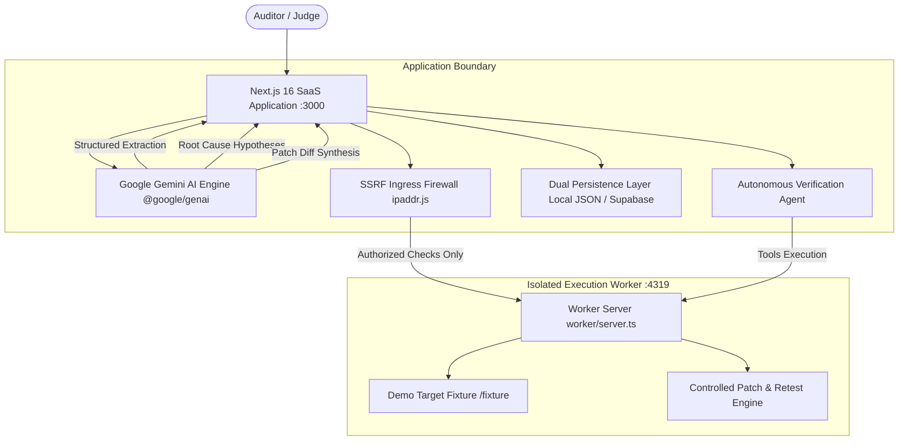

# PROOFCHAIN.AI — System Architecture & Design

## 1. High-Level Architecture

PROOFCHAIN.AI is built on a decoupled, secure architecture ensuring that untrusted user repositories and test targets never execute on the application server.

---

## 2. Core Workflow Pipeline

```mermaid
flowchart LR
    A[Project Input] --> B[Claim Extraction]
    B --> C[Evidence Indexing]
    C --> D[Requirement Mapping]
    D --> E[Test Planning]
    E --> F[Authorized Tool Exec]
    F --> G[Finding Classification]
    G --> H[Root Cause AI]
    H --> I[Recovery Plan]
    I --> J[User Approval]
    J --> K[Controlled Fix]
    K --> L[Automatic Retest]
    L --> M[Release Verdict]
```

---

## 3. Autonomous Verification Agent Tools

The autonomous agent executes up to 8 bounded steps with strict Zod argument validation:

1. `retrieve_project_requirements`: Fetches formal requirements and acceptance criteria.
2. `search_evidence`: Queries indexed evidence artifacts by keyword.
3. `inspect_repository_metadata`: Inspects package manifests, CI workflows, and READMEs.
4. `inspect_source_file`: Reads specific source files with path-traversal prevention.
5. `check_public_endpoint`: Executes SSRF-validated HTTP GET/POST requests.
6. `retrieve_test_result`: Fetches prior execution outcomes for a claim.
7. `run_approved_browser_test`: Dispatches approved tests to the isolated worker.
8. `record_finding`: Records empirical defect findings with severity levels.
9. `generate_verification_summary`: Computes the release gate score and verdict.

---

## 4. Autonomous Recovery Studio Lifecycle

1. **Failure Discovery**: Test execution confirms a defect (e.g., HTTP 404 broken navigation link).
2. **Diagnosis**: Gemini investigates failure traces and ranks plausible root causes.
3. **Patch Generation**: Minimal unified diff is generated targeting the isolated fixture (`worker/fixture.ts`).
4. **User Review**: Diff is displayed to the auditor; explicit user authorization is required.
5. **Isolated Application**: Patch is applied exclusively in the test worker environment.
6. **Automatic Retest**: The failing test is immediately re-executed against the patched target.
7. **Empirical Certification**: If retest passes, claim status transitions from `CONTRADICTED` to `VERIFIED`.
8. **Rollback Safety**: Auditor can revert the patch at any time with one click.

